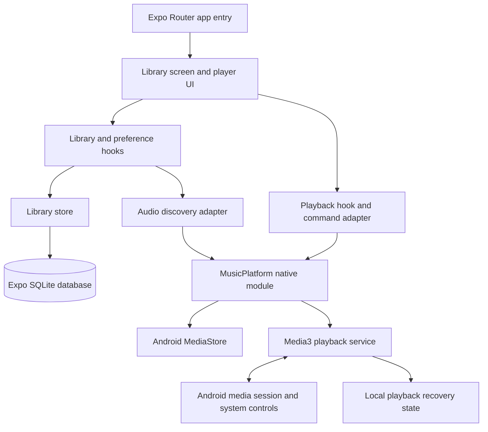

# Architecture and system design

## System overview

The project is an Android-only React Native app. Expo Router provides the app entry point. React Native screens coordinate the library and preferences; SQLite stores the library and collections; the local Kotlin Expo module handles Android MediaStore discovery and owns the Media3 playback service.

The diagram shows the main ownership boundaries. Native playback events also flow back through the module to the app’s playback hook and subscribed screens.

## Responsibilities and state ownership

| Component | Responsibility | Authoritative state |
| --- | --- | --- |
| `app/` | Expo Router entry points and app composition | Route/screen lifetime |
| `src/features/library/` | Library screens, search, playlist edits, preferences, and playback presentation | Temporary UI state |
| `src/features/library/libraryStore.ts` | Serialized collection and preference operations | Playlist membership, favourites, and saved appearance |
| `src/infrastructure/libraryDatabase.ts` | Opens the SQLite database | Database connection |
| `src/infrastructure/native/` | TypeScript adapters for discovery and playback | No independent source of native playback truth |
| `modules/music-platform/` | Kotlin bridge, MediaStore discovery, Media3 service, queue policy, and recovery | Active playback session, queue, and playback state |
| Android MediaStore | Indexed audio and current provider bindings | Whether a source is currently available to the app |

The SQLite library is a local catalogue and collections store. It is not proof that a previously discovered file remains accessible. Discovery results are revalidated against current Android access before they are committed or played. The app does not accept arbitrary filesystem paths or network URLs as playable sources.

## Library and collection flow

1. On launch or return to the foreground, the library loads saved database state and checks current Android audio permission.
2. With permission, the native module discovers indexed audio. A manual refresh uses the same path.
3. Only a complete scan with still-valid access is committed. Cancellation, permission changes, or failed scans preserve the previous saved catalogue.
4. The UI searches the saved snapshot by filename, title, or artist. Playlist and favourite writes go through serialized SQLite transactions.

Playlist membership and ordering are local records. Collection operations do not write to the original audio files.

## Playback and recovery flow

The Kotlin playback service owns the active Media3 player, queue order, session identity, state revision, and recovery state independently of React screen lifetime. TypeScript sends validated commands through the native bridge and renders accepted service snapshots. Android media-session controls use the same service as in-app controls.

Selecting a song submits the currently visible list as a queue. Queue-specific operations are checked against the current service state so stale commands cannot silently operate on a newer queue. Playback recovery restores a saved context paused; the app does not automatically resume audio after process recreation. If a source becomes inaccessible, the service reports the error and applies its bounded skip/recovery policy.

## Persistence and failure boundaries

SQLite stores discovered metadata, availability, favourites, playlists, playlist order, and appearance preferences. The native service stores playback recovery data in app-private storage. Both are local to the installation and have no user-facing export or backup workflow.

Permission loss disables operations that require audio access while retaining saved collections. A failed scan or database write reports an error and retains the prior committed state where possible. Severe database corruption, Android provider changes, operating-system process termination, and manufacturer background restrictions remain outside guarantees.

## Source map

- `app/`: Expo Router entry points.
- `src/core/platform/`: TypeScript contracts and platform-independent playback state helpers.
- `src/features/library/`: user-facing library and player features.
- `src/infrastructure/`: SQLite and native-module adapters.
- `modules/music-platform/android/`: Kotlin/Media3 implementation and native unit tests.
- `plugins/`: generated Android configuration changes applied during prebuild.
- `scripts/`: Windows build workflow, fixture generator, and host tests.

Generated Android project files and local build outputs are not the source of truth. Native changes belong in app configuration, config plugins, or the local module.
